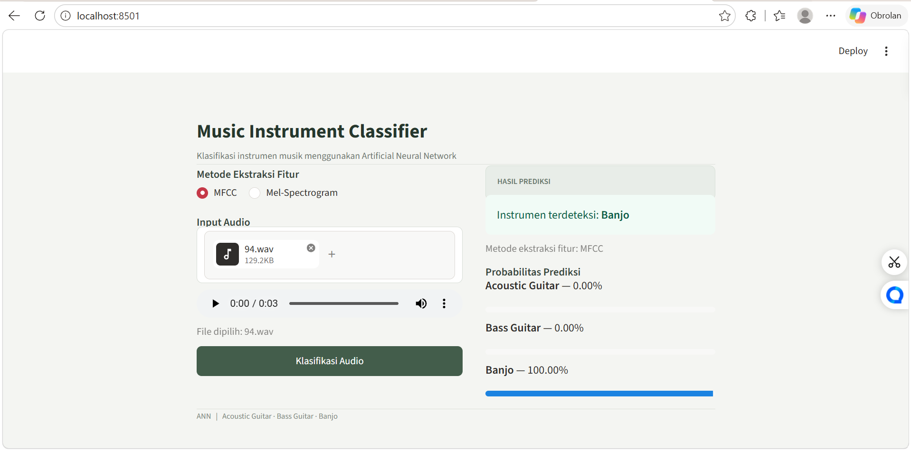

# Klasifikasi Instrumen Musik dengan ANN

Project ini merupakan program untuk mengklasifikasikan instrumen musik berdasarkan file audio menggunakan Artificial Neural Network (ANN). Model dilatih menggunakan fitur audio yang diekstraksi dengan dua metode, yaitu Mel-Frequency Cepstral Coefficients (MFCC) dan Mel-Spectrogram.

Pada project ini, klasifikasi dilakukan terhadap tiga jenis instrumen musik, yaitu Acoustic Guitar, Bass Guitar, dan Banjo. Aplikasi dibuat menggunakan Streamlit sehingga pengguna dapat memasukkan file audio dan melihat hasil prediksi secara langsung.

## Tampilan Aplikasi



## Dataset

Dataset yang digunakan pada project ini berasal dari Kaggle:

**Music Instrument Sounds for Classification**

Link dataset: [Download Dataset](https://www.kaggle.com/datasets/abdulvahap/music-instrunment-sounds-for-classification)

Dataset berisi rekaman audio instrumen musik yang dikelompokkan berdasarkan jenis instrumen. Data yang digunakan pada project ini difokuskan pada tiga kelas:

| Kelas | Instrumen |
|---|---|
| Acoustic_Guitar | Gitar akustik |
| Bass_Guitar | Gitar bass |
| Banjo | Banjo |

Dataset tidak disertakan dalam repository GitHub. Jika ingin melakukan training ulang, dataset perlu diunduh secara terpisah.

## Metode

### MFCC (Mel-Frequency Cepstral Coefficients)

MFCC digunakan untuk mengambil karakteristik audio melalui representasi spektrum frekuensi pada skala Mel. Fitur yang dihasilkan diringkas menggunakan mean dan standard deviation untuk membentuk representasi audio yang digunakan sebagai input model.

### Mel-Spectrogram

Mel-Spectrogram digunakan untuk merepresentasikan energi sinyal audio pada rentang frekuensi berdasarkan skala Mel. Hasil ekstraksi fitur diringkas menggunakan mean dan standard deviation dari filter bank.

### ANN (Artificial Neural Network)

Artificial Neural Network digunakan untuk mempelajari pola dari fitur audio hasil ekstraksi. Model yang telah dilatih kemudian digunakan untuk memprediksi jenis instrumen musik berdasarkan fitur dari audio yang dimasukkan.

## Struktur Project

```text
Klasifikasi_Instrumen_Musik_Kelompok5/
│
├── app.py
├── ann.py
├── audio_processing.py
├── feature_extraction.py
├── preprocessing.py
├── config.py
├── requirements.txt
│
├── training.py
├── training_mel.py
├── evaluasi_test.py
├── evaluasi_mel_test.py
│
├── dataset/                         # Dataset (tidak disertakan)
│   ├── Acoustic_Guitar/
│   ├── Bass_Guitar/
│   └── Banjo/
│
├── hasil/
│   ├── model/
│   │   ├── model_mfcc_terbaik.json
│   │   └── model_mel_terbaik.json
│   │
│   └── preprocessing/
│       ├── mfcc_parameter_normalisasi.json
│       └── mel_parameter_normalisasi.json
│
└── docs/
    └── screenshot_aplikasi.png
```

## Persyaratan

Sebelum menjalankan project, pastikan beberapa hal berikut sudah tersedia:

- Python 3.11
- Conda (disarankan untuk mengelola environment)
- Git
- Library yang tercantum pada `requirements.txt`

## Getting Started

### 1. Clone Repository

Clone repository ini ke komputer menggunakan perintah:

```bash
git clone https://github.com/Anitawidyastini/Klasifikasi_Instrumen_Musik_Kelompok5.git
```

Masuk ke folder project:

```bash
cd Klasifikasi_Instrumen_Musik_Kelompok5
```

### 2. Membuat Environment

Untuk menghindari konflik library dengan project Python lainnya, buat environment baru menggunakan Conda:

```bash
conda create -n musik_ann python=3.11
```

Setelah proses pembuatan environment selesai, aktifkan environment:

```bash
conda activate musik_ann
```

### 3. Install Dependencies

Install seluruh library yang dibutuhkan dengan menjalankan:

```bash
pip install -r requirements.txt
```

Tunggu hingga proses instalasi selesai.

### 4. Menjalankan Aplikasi

Jalankan aplikasi menggunakan Streamlit:

```bash
streamlit run app.py
```

Jika berhasil, Streamlit akan memberikan alamat aplikasi pada terminal. Buka alamat tersebut melalui browser, biasanya:

```text
http://localhost:8501
```

## Menggunakan Aplikasi

Setelah aplikasi terbuka di browser, ikuti langkah berikut:

1. Pilih metode ekstraksi fitur yang tersedia, yaitu MFCC atau Mel-Spectrogram.
2. Upload file audio instrumen musik yang ingin diuji.
3. Jalankan proses klasifikasi melalui aplikasi.
4. Tunggu hingga proses ekstraksi fitur dan prediksi selesai.
5. Hasil klasifikasi akan menampilkan jenis instrumen musik yang diprediksi oleh model.

## Training Model

Repository ini sudah menyediakan model hasil training beserta parameter normalisasi yang digunakan, sehingga aplikasi dapat langsung dijalankan tanpa melakukan training ulang.

Jika ingin melakukan training ulang menggunakan dataset, pastikan dataset sudah ditempatkan pada folder `dataset` sesuai kelas instrumennya.

Training model MFCC dapat dilakukan melalui:

```bash
python training.py
```

Training model Mel-Spectrogram dapat dilakukan melalui:

```bash
python training_mel.py
```

File evaluasi model juga tersedia untuk menjalankan pengujian terhadap data test:

```bash
python evaluasi_test.py
```

```bash
python evaluasi_mel_test.py
```

## Catatan

- Dataset tidak disertakan dalam repository dan dapat diunduh melalui link Kaggle yang telah dicantumkan.
- Model hasil training sudah tersedia di folder `hasil/model`.
- Parameter normalisasi model tersedia di folder `hasil/preprocessing`.
- Training ulang tidak diperlukan hanya untuk menjalankan aplikasi klasifikasi.
- Pastikan environment sudah aktif dan dependencies telah terinstall sebelum menjalankan program.

## Kelompok 5

Pengantar Komputasi Lunak  
Program Studi Informatika